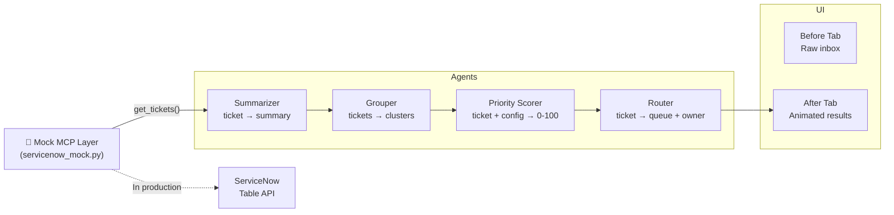

# Triage Copilot — Demo Guide

**Hackathon:** Keck Medicine of USC · Agentic AI in Healthcare  
**Team:** Data Engineering  
**Prototype:** Triage Copilot v0.3 (hackathon build)

---

## TL;DR

One-sentence pitch: **"An AI agent that reads the on-call queue, groups duplicates, scores tickets by clinical impact, and routes each one — cutting triage time from 3.8 hours to ~33 minutes."**

What judges see: a split Before/After demo. Click **Run Triage**, watch four agent steps animate in ~6 seconds, then walk through the results.

---

## Pre-recording / pre-demo checklist

- [ ] `streamlit run app.py` is running at `http://localhost:8501`
- [ ] Browser tab is open to the app, full-screen, 1080p or wider
- [ ] Sidebar sliders are at defaults: Manual = 6 min, Review = 1.5 min
- [ ] **After** tab is showing only the "Run Triage" button (no results yet)
  - If results are showing: click **↺ Reset**
- [ ] Screen recording software is armed (if recording)
- [ ] Phone/Slack notifications silenced

---

## Step-by-step timing table (4–5 min version)

| Time | Tab | Action | What to say |
|------|-----|---------|-------------|
| 0:00 | Before | Show the raw inbox | "This is what on-call sees today — 38 tickets, no scores, no grouping." |
| 0:20 | Before | Point to red callout | "A possible PHI exposure came in by email. ServiceNow auto-filed it as Low. It's been sitting at row 19 for 11 hours." |
| 0:40 | Before | Point to orange callout | "22 of these 38 tickets are duplicates. Without grouping, the analyst investigates each one separately." |
| 0:55 | Before | Show Excel mock (expand) | "Today the team fills in a shared Excel sheet by hand — no audit trail, no consistency." |
| 1:10 | After | Switch to After tab | "Here's what the AI agent does instead." |
| 1:20 | After | Click **▶ Run Triage** | "Four agents run in sequence." (let animation play — ~6 s) |
| 1:30 | After | Animation step 1 | "Summarizer — plain-English summary of every ticket." |
| 1:35 | After | Animation step 2 | "Grouper — finds the 16 duplicate clusters." |
| 1:40 | After | Animation step 3 | "Priority Scorer — 0–100 score based on clinical impact, users affected, SLA." |
| 1:45 | After | Animation step 4 | "Router — assigns each issue to the right team and owner." |
| 1:55 | After | KPI panel | "38 tickets → 22 unique issues. 2 critical surfaced automatically. Estimated triage time: 33 minutes vs 3.8 hours — 86% reduction." |
| 2:10 | After | First issue card (PHI) | "The PHI ticket is now at the top, scored 97/P1. Click 'Why this score' to see the breakdown." |
| 2:25 | After | Score breakdown expander | Walk through the per-factor table — users affected, patient care criticality, SLA remaining. |
| 2:45 | After | Duplicate Groups tab | "The Cerner ADT failure — 7 tickets collapsed into one issue. Callers get one consistent response." |
| 3:10 | After | Routing tab | "Each issue goes to the right queue with a confidence score. Low-confidence routes are flagged for review." |
| 3:30 | After | Triage a new ticket | Type a short incident description, click **Score & route this ticket**. |
| 4:00 | — | Q&A / wrap-up | See Q&A section below. |

---

## 90-second short version

| Time | Action |
|------|--------|
| 0:00 | Show Before tab — raw inbox, red PHI callout |
| 0:20 | Switch to After — click Run Triage |
| 0:30 | Animation plays |
| 0:40 | KPI panel — "3.8 hrs → 33 min" |
| 0:55 | PHI ticket at top, P1, score 97 — open breakdown |
| 1:15 | Reset and hand back |

---

## Agent architecture

**Data flow (demo mode):**  
`tickets.json` → MCP mock → Agents (read precomputed `ai_*` fields) → UI tabs

**Data flow (production):**  
ServiceNow MCP → Agents (LLM calls + rule engine) → ServiceNow writes back via PATCH

---

## Q&A cheat sheet

**"Is this connected to real ServiceNow?"**  
No — all 38 tickets are synthetic, generated for this demo. The mock MCP layer (`tools/servicenow_mock.py`) logs every "call" to the console with the exact endpoint it would hit in production. No real data, no PHI.

**"Where do the priority scores come from?"**  
A weighted rule engine defined in `config/scoring.json`. Six factors (patient care criticality, users affected, urgency, SLA remaining, no workaround, is outage) with configurable weights. For the hackathon the weights are placeholders — calibration against historical tickets is the next step.

**"Why precomputed? Can it score tickets in real time?"**  
Yes. The scorer (`agents/scorer.py`) is a pure function — it already runs on the live "Triage a new ticket" tab. Connecting it to a live LLM for the summary step is a config change in `agents/summarizer.py` (`DEMO_MODE = False` + fill in `_call_llm()`).

**"How does the grouper work?"**  
In this demo, grouping is precomputed from `group_id` fields in the data. In production it would use embedding similarity (e.g. `text-embedding-3-small`) to cluster semantically related tickets, then an LLM to label each cluster.

**"What's MCP?"**  
Model Context Protocol — an open standard for connecting AI agents to external tools and data sources. The mock layer in this demo mirrors the exact ServiceNow Table API endpoints an approved MCP server would expose in production.

**"What would it take to go live?"**  
Three things: (1) a ServiceNow MCP server approved by IT, (2) validated scoring weights from a historical data study, (3) an LLM API key for the Summarizer. The routing and grouping logic can ship as-is for a pilot.

**"What about patient privacy?"**  
The tickets never leave ServiceNow in this architecture — the MCP server runs inside Keck's network boundary. Summaries are generated from ticket text that already exists in ServiceNow. No PHI is sent to a third-party LLM without the same controls that govern current ServiceNow access.

---

## Fallback plan

| Problem | What to do |
|---|---|
| Streamlit won't start | Open `data/tickets.json` in a text editor and walk through a few raw tickets + the `ai_*` fields by hand |
| "Run Triage" button hangs | Refresh the page; if the server died, restart: `streamlit run app.py` |
| Browser layout broken | Try Chrome; zoom out to 80% |
| Score breakdown not showing | Click the expander arrow — it's collapsed by default |
| Live ticket scorer gives an error | Fall back to the precomputed cards in the Triage Queue tab |

---

## Recording tips

- Record at 1080p or 1440p, 30 fps minimum.
- Use a browser profile with no extensions visible in the toolbar.
- Full-screen the browser before starting.
- If possible, record a dry run first — the Run Triage animation is 6 seconds, which can feel slow if you talk over it instead of letting it breathe.
- Zoom in (⌘+) when showing the score breakdown table so it's readable.
- Keep mouse movement slow and deliberate on the KPI panel numbers.

---

## Data & responsible AI

**All data is synthetic.** The 38 tickets were generated for this demo. No real patient, employee, or Keck Medicine data was used. No PHI. The ticket numbers, caller names, descriptions, and clinical scenarios are entirely fictional.

**Scoring weights are placeholders.** The current weights in `config/scoring.json` have not been validated against production data. Before clinical deployment, weights should be calibrated in collaboration with clinical operations and validated against a labeled historical dataset with clinical review.

**Humans stay in the loop.** The agent suggests — it does not act. Every ticket card requires a one-click accept ("Link & notify caller", "Mark routed") before anything is written back to ServiceNow. Low-confidence routes are flagged for manual review.

**Explainability.** Every priority score includes a per-factor breakdown so the analyst can see exactly why a ticket was scored P1 vs P2.

---

## Next steps / roadmap

| Priority | Item |
|---|---|
| High | Calibrate scoring weights against 6 months of historical DE tickets |
| High | Connect Summarizer to Claude claude-haiku-5-5 via Anthropic API |
| High | Stand up a ServiceNow MCP server behind Keck's firewall |
| Medium | Run a 2-week pilot with the DE on-call rotation |
| Medium | Add embedding-based grouper (replace precomputed `group_id`) |
| Medium | Add "accept all" batch routing for low-complexity triages |
| Low | Extend to other assignment groups (IS Infrastructure, Clinical Apps) |
| Low | Dashboard: week-over-week triage time and queue depth trends |
| Low | Slack/Teams notification integration for P1 escalations |
